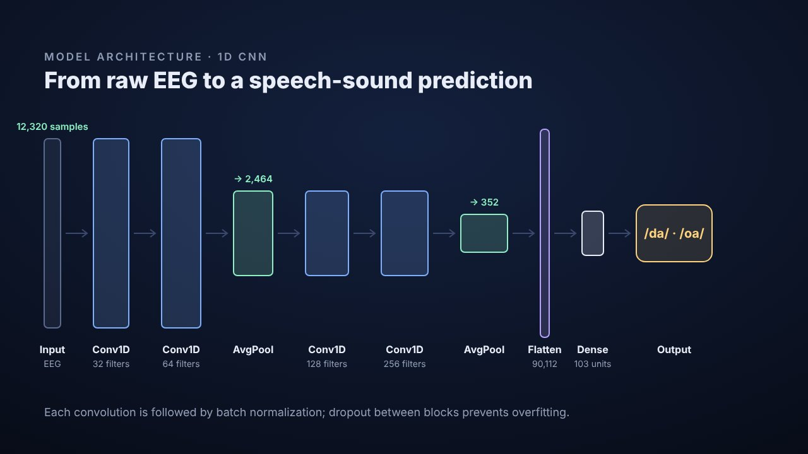
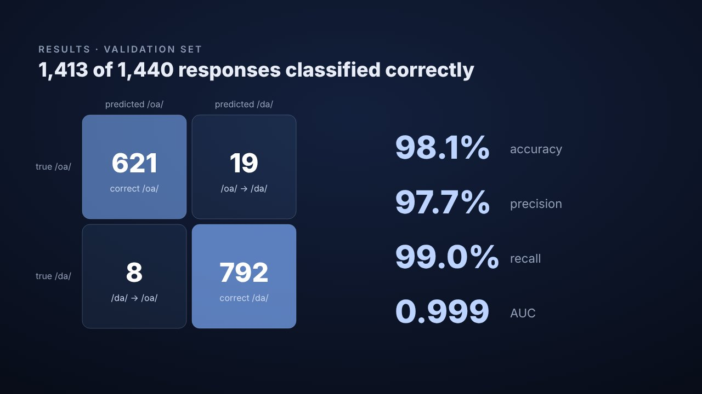

# Deep learning on neonatal EEG

A 1D convolutional neural network that tells apart newborns' EEG responses to two speech sounds, **/da/** and **/oa/**. This is the code from my Master's thesis in Computational Neuroscience (2022).

**Why it matters:** dyslexia is usually diagnosed years after it starts. Early signs may already show in how a newborn's brain processes speech. A model that reliably separates responses to similar speech sounds is a first step towards using EEG as an early biomarker.

📄 [Read the thesis (PDF)](https://www.laura-winkler.com/thesis.pdf)

## Results

Evaluated on **9 newborns the model had never seen** (1,440 trials), after training on the remaining 77:

| Binary accuracy | Precision | Recall | AUC |
|---|---|---|---|
| **98.1 %** | 97.7 % | 99.0 % | 0.999 |

On the training participants, 4-fold cross-validation reached 98.5 % ± 0.3 % binary accuracy (AUC 0.998).

> **Note on the metrics in the notebook:** the column called `accuracy` (≈ 0.003) is Keras' exact-match `Accuracy`, which doesn't make sense for a sigmoid output. The relevant metric is `binary accuracy`.

## What the notebook does

1. **Data preparation:** sorts the raw `.mat` recordings into one folder per participant and stimulus, loads them into pandas and labels them (/oa/ = 0, /da/ = 1)
2. **Cleaning:** merges 12,320 trials (86 newborns in total) and drops trailing zero-padded time points, so the model can't learn from padding instead of brain signal
3. **Model:** 4 convolutional layers (32 → 256 filters) with batch normalization, average pooling and dropout, followed by a dense layer and a sigmoid output; Adam (lr 1e-4), binary cross-entropy, 60 epochs
4. **Evaluation:** 4-fold cross-validation, then a final model trained on all training participants and tested on the held-out participants
5. **Experiments:** extra runs comparing the model with and without batch normalization and with different dropout placements

## Data

The EEG recordings belong to the research group where the thesis was done and are **not included** in this repository. The notebook shows all outputs from the original run, so the full pipeline and results can be followed without the data.

## Tech

Python · TensorFlow 2.8 / Keras · scikit-learn · pandas · NumPy · SciPy · Matplotlib · Google Colab (GPU)

## Run it

Open `neonatal-eeg-1d-cnn.ipynb` in Google Colab, switch the runtime to GPU and upload the data into the folders the notebook creates. Training one model takes about 30 minutes on a Colab GPU.
